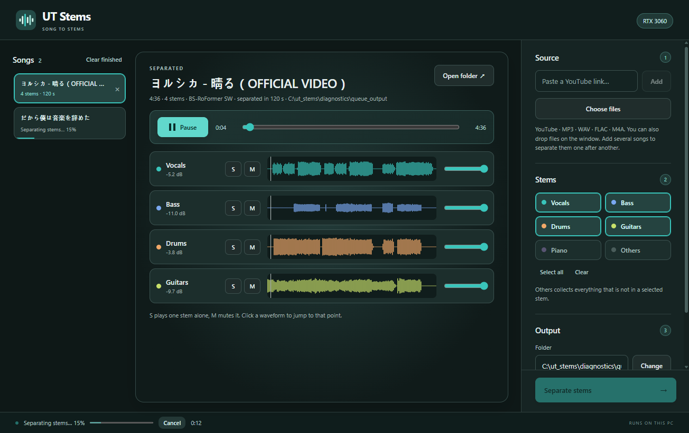

# UT Stems

Split a song into separate instrument tracks. Give it an audio file or a YouTube link and it writes
up to six MP3 stems: **vocals, bass, drums, guitars, piano, others**.

Everything runs on your own PC. It comes as a desktop app and as a command.



## What it does

- **Input**: an audio file (MP3, WAV, FLAC, M4A, anything ffmpeg reads) or a YouTube link.
  A link is downloaded as audio only and saved as `<title>.mp3` next to the stems.
- **Stems**: pick any of the six. `others` collects everything that is not in a selected stem, so
  with `others` selected the files always add up to the whole song. Without it, the rest is not written.
- **Output**: `<songname>_<instrument>.mp3` at 320 kbps, in the folder you choose.
- **Queue**: add several files or links and they are separated one after another.
- **Mixer** (desktop app): waveform, solo, mute and volume per stem, with synchronised playback.
  A stem with nothing in it is marked *silent*.

The default model is BS-RoFormer SW; HT-Demucs 6s is available as a faster alternative.
On an RTX 3060 a 4-minute song takes about a minute and uses under 4 GB of VRAM.

## Download (no installation)

The [latest release](https://github.com/zeberity123/ut_2_stems/releases/latest) has the app as a
folder with everything inside: the window, Python, PyTorch, the CUDA libraries and ffmpeg. Nothing
else needs to be installed, not even Python or the CUDA toolkit.

| Download | For | Size |
|---|---|---|
| `UT-Stems-<version>-win64-cuda.7z.001` | PCs with an NVIDIA GPU (GTX 10 series or newer, current driver) | about 1.7 GB |
| `UT-Stems-<version>-win64-xpu.7z.001` | PCs with an Intel GPU: Arc A/B series, or the Arc graphics in Core Ultra laptops | about 1.2 GB |
| `UT-Stems-<version>-win64-cpu.zip` | everything else (no GPU, or an AMD GPU) | about 410 MB |

Every edition also runs on the CPU when its GPU is not found, so the CUDA edition is a safe choice
for any PC; the others are just smaller.

1. Download the file (if an edition has several parts, `.001`, `.002`, …, put them in the same folder).
2. Extract: right-click the `.zip` > **Extract all**, or for a `.7z.001` file install
   [7-Zip](https://www.7-zip.org/) and right-click it > **7-Zip > Extract here**. GitHub limits files to
   2 GB, which is why the GPU editions are 7z files, possibly in parts.
3. Open the `UT Stems` folder and double-click **UT Stems.exe**. Windows SmartScreen may warn because
   the program is not signed: **More info > Run anyway**.

The command line is in the same folder: `ut-stems.cmd "song.mp3" -o D:\stems`.

**GPU or CPU.** Nothing besides the graphics driver needs to be installed: the CUDA edition carries
the CUDA runtime and the XPU edition carries Intel's oneAPI runtime. The header shows which device is
in use; *CPU · no supported GPU found* means the edition could not use a GPU, and the app then
recommends HT-Demucs 6s under the model choice. Times for a 4-minute song:

| Model | 8-core CPU (i7-10700F) | RTX 3060 |
|---|---|---|
| BS-RoFormer SW (default, best quality) | about 25 min | about 1 min |
| HT-Demucs 6s (choose it under *Advanced*) | about 2 min | about 15 s |

A laptop CPU with fewer cores takes proportionally longer. Intel GPUs: the XPU edition uses PyTorch's
Intel GPU back end, which needs a recent Intel graphics driver
([intel.com/download](https://www.intel.com/content/www/us/en/download-center/home.html), Arc or
Core Ultra graphics driver). It has not been timed on Intel hardware yet. Intel's NPU (*AI Boost*) is
not used: the separation models would have to be converted to OpenVINO first.

## Running from source

### Requirements

- Windows 10/11
- Python 3.10 or newer, on PATH (`winget install Python.Python.3.10`)
- An NVIDIA GPU with a current driver (it also runs on CPU, much slower)
- About 10 GB of free disk space
- ffmpeg and Node.js: `setup.bat` installs both with winget if they are missing

### Setup

```
git clone https://github.com/zeberity123/ut_2_stems.git
cd ut_2_stems
setup.bat
```

Without git, use **Code > Download ZIP** on GitHub, unzip, and run `setup.bat` in the folder.

`setup.bat` does four things:

1. installs ffmpeg if it is missing
2. installs Node.js if it is missing (for the desktop window and for YouTube downloads)
3. installs the Python packages into your default Python, with no virtual environment. PyTorch is
   a download of about 2.5 GB; an existing PyTorch is kept as it is.
4. installs Electron for the desktop window

If it had to install ffmpeg or Node.js, start `run.bat` from a new window so they are found.
The first separation downloads the model checkpoint (about 670 MB) to
`%USERPROFILE%\.cache\bs-roformer-infer`.

The repository holds only code. Songs, separated stems and model files are never uploaded.

## Use

### Desktop app

Double-click `run.bat`.

1. Paste a YouTube link, choose files, or drop files on the window.
2. Select the stems you want.
3. Choose the output folder and press **Separate stems**.

When it finishes, the stems open in the mixer and **Open folder** shows the files.

To separate several songs, add them one by one with **Add** (or Enter), or pick several files at
once. They appear in the **Songs** list on the left and nothing starts until you press
**Separate**. Then:

- to rename a song, double-click it in the list or press **✎**, type the name and press Enter
  (Esc cancels). Before separation the files are then written under that name; after it, the
  files already written are renamed (an existing file of that name is never overwritten).
- a YouTube song you did not rename takes the video title as soon as it starts
- the songs run one after another with the stems, folder and model set at that moment
- you can open and play a finished song while the next one is running
- songs added during a run wait until you press **Separate** again
- **Cancel** stops the run and puts the unfinished songs back to *Ready*
- a song that fails is marked *Failed* and the rest carry on

Under **Advanced** → *Files* there are two toggles, both on by default:

- **Auto title**: a YouTube song you did not rename is named after its video title. Off, it is
  named after its video id (for example `suv0x6HfRhw_vocals.mp3`).
- **Keep original MP3**: the downloaded song stays next to the stems as `<songname>.mp3`. Off, it
  is deleted once the stems are written. Files you chose yourself are never deleted.

### Command line

The `ut-stems` command works from any folder.

```
ut-stems "song.mp3"
ut-stems "song.mp3" -o D:\stems
ut-stems "first.mp3" "second.mp3" "https://youtu.be/suv0x6HfRhw"
ut-stems "https://youtu.be/suv0x6HfRhw" --stems vocals,bass,drums,guitars
```

| Option | Meaning | Default |
|---|---|---|
| `-o`, `--out` | output folder | `./output` |
| `--stems` | comma-separated stems to write | all six |
| `--model` | `bs_roformer_sw` or `htdemucs_6s` | `bs_roformer_sw` |
| `--overlap` | `2`, `3` or `4`; higher is slower and slightly smoother | `2` |
| `--bitrate` | MP3 bitrate | `320k` |
| `--device` | `auto`, `cuda` (NVIDIA), `xpu` (Intel GPU) or `cpu` | `auto` |

## How it is built

| Part | Where |
|---|---|
| Separation, YouTube download, MP3 I/O | `ut_stems/` (Python) |
| One pipeline shared by the app and the command | `ut_stems/pipeline.py` |
| Local server for the app (127.0.0.1, session token) | `ut_stems/server.py` |
| Interface | `web/` |
| Desktop shell | `desktop/` (Electron) |
| Standalone build | `packaging/` (PyInstaller spec, Electron packager, `build.ps1`) |

The app structure and look follow [yt_to_score](https://github.com/zeberity123/yt_to_score); the
YouTube audio download follows [ut_downloader](https://github.com/zeberity123/ut_downloader).

## Tests

```
python -m pytest             fast tests, no model needed
python -m pytest -m slow     separation on a short clip, needs the GPU
npm run test:desktop         launches the app, queues two clips, checks the list and the mixer
```

## Building the standalone app

`packaging\build.ps1` builds the folder that the releases contain. It needs 7-Zip
(`winget install 7zip.7zip`) and Node.js, and about 15 GB of free disk space for the CUDA edition.

```
packaging\build.ps1 -Edition cuda                                        # default Python has the CUDA torch
packaging\build.ps1 -Edition xpu -Python C:\envs\xpu\Scripts\python.exe  # a Python with torch from whl/xpu
packaging\build.ps1 -Edition cpu -Python C:\envs\cpu\Scripts\python.exe  # a Python with the CPU torch
```

The result is `dist\UT-Stems-<version>-win64-<edition>\UT Stems\` plus the archive next to it.
Inside, `resources\engine\` holds the Python side as `ut-stems-engine.exe` (the local server) and
`ut-stems.exe` (the command line), built from `packaging\ut_stems.spec`; the window is Electron with
the engine folder dropped into `resources\`. When packaged, the window runs the engine instead of
`python -m ut_stems.server`, and lends itself to yt-dlp as the Node.js runtime that YouTube
downloads need.

## Notes

- The packaged app includes ffmpeg from [gyan.dev](https://www.gyan.dev/ffmpeg/builds/) (GPL; its
  licence is in `resources\engine\ffmpeg-LICENSE.txt`), PyTorch, yt-dlp, Demucs and BS-RoFormer.

- The BS-RoFormer SW checkpoint is a community release whose licence is listed as unknown on
  Hugging Face. It is downloaded at run time and is not part of this repository.
- Only download and separate music you have the right to use.
- `PLAN.md` records the model comparison and the decisions made along the way.
